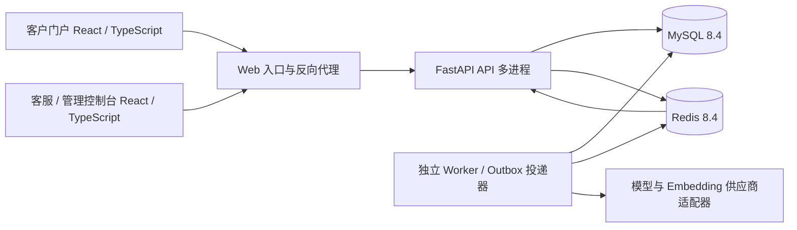

# ServiceHub AI：智能售后客服与知识库问答平台

日期：2026-10-20。状态：设计已获用户确认，代码已按批准计划实现，验证状态见 docs/verification。

## 1. 目标与已确认约束

用户希望补充一个可用于 AI 全栈求职的完整项目，业务选择为「电商售后客服 + 知识库问答」，要求具有企业应用的工程深度，避免只做聊天页面和模型接口包装。

已确认技术栈：React、TypeScript、FastAPI、MySQL、Redis；需要实现并验证实际并发场景。

交付目标是能运行、能演示、能测试、能说明设计取舍的完整源码项目。企业应用的标准体现在权限边界、数据正确性、故障恢复、可观测性和部署方式；吞吐能力以实际压测结果为依据，不预写生产规模和性能数字。

场景假设：使用虚构的数码商品商城、演示客户及订单。面向网站聊天入口，不接真实支付、退款或物流生产系统。默认本地开发与部署交付，不发布到外部托管平台。

## 2. 方案选择

采用「模块化单体 API + 独立异步 Worker + 前后端分离」。API 内按认证、会话、知识库、订单、售后、审计、指标分模块，通过明确的服务接口调用；Worker 和 API 复用领域代码，不依赖 API 进程内存。

选择理由：相较纯知识库问答，完整客服流程能呈现更多业务后端能力；相较拆成多个微服务，这个结构能保留清晰边界、跨进程并发和故障恢复能力，同时降低开发、部署与演示成本。

不在首版引入 Kubernetes、Kafka、多地区容灾或复杂服务治理。Redis 同时承接缓存、会话、限流、消息通知与任务分发；MySQL 是业务数据的权威来源。

## 3. 用户与权限

- 租户管理员：管理本租户客服成员、知识库、工单和审计记录，查看模型接入状态。
- 客服：查看本租户待接入队列，领取会话，人工回复，查询相关订单，处理售后工单。
- 客户：查看自己的订单、会话、消息、知识引用和售后申请。

采用服务端登录会话，使用 256 位随机会话标识，服务端保存其摘要和身份映射，默认有效期 8 小时。浏览器使用 HttpOnly Cookie；有状态写请求校验 CSRF，WebSocket 校验会话和 Origin。密码使用 Argon2id 哈希存储。

首版账号固定所属租户，不提供跨租户切换。租户和角色从已验证身份推导，不信任请求体自行提供的租户标识。每个查询和写操作均做服务端授权；前端按钮隐藏不能代替权限检查。

所有业务表带 tenant_id，关联关系使用能校验租户一致性的约束。知识检索、订单工具和导出同样执行租户与客户归属检查。演示数据至少包含两个租户、两个客服及两个客户，以验证隔离。

## 4. 首版完整业务范围

### 4.1 客户门户

登录、创建与查看历史会话、发送消息、接收 AI 流式回复、查看引用来源、查询自己的订单、申请人工客服、提交售后申请、查看处理结果。

发送状态区分发送中、已保存和失败；重试沿用原消息标识。AI 超时或无知识依据时提供明确状态和人工入口。

### 4.2 客服工作台

待接入和处理中列表，支持筛选、服务端分页及会话搜索；提供客户信息、订单摘要、聊天历史、接单、人工回复、创建与处理售后工单、结束会话。

客服接入后，系统停止为该会话提交 AI 正式回复。重复接单、他人已领取和版本冲突在界面有明确反馈。

### 4.3 知识库管理

管理员导入 TXT、Markdown 和含文本层的 PDF；限制单文件 10 MiB，扫描 PDF 不在首版 OCR 范围内。导入经过上传、解析、分块、索引、启用或失败状态，展示后台进度和可重试错误。

文档、版本、分块和来源元数据保存在 MySQL。索引可由权威数据重新构建；文档删除或停用后立即从可引用范围移除。

原始文档使用服务端生成的文件标识保存于私有持久卷，API 与 Worker 共享访问。下载与引用内容读取均走鉴权接口，不暴露可绕过权限的静态文件路径。

### 4.4 订单与售后

演示订单具备订单号、客户、商品、金额、订单状态、物流摘要及时间记录。客户只能查询本人订单。

售后申请记录关联订单、申请类型、说明、处理客服、处理状态及流转记录。首版仅创建和处理申请，不执行真实资金退款。

### 4.5 管理与运营

提供客服成员管理、角色控制、任务失败记录、敏感操作审计和基础运营指标。图表来自真实数据库查询；不以随机数伪造业务统计。

统计至少包含会话量、待接入量、转人工比例、响应耗时和任务失败量。无真实模型用量时标记不可用，不编造 Token 或成本数据。

## 5. 前端结构与视觉

客户门户与内部控制台采用独立路由及访问控制。控制台以会话处理为核心，包含会话、订单、售后工单、知识库、运营概览和设置入口。

采用简洁的企业控制台样式：浅色背景、清晰表格和状态标签、适度信息密度、统一间距和操作反馈。会话工作台使用队列、对话和客户上下文三栏布局，在窄屏降为分步视图。

所有业务页面处理加载、空数据、失败、无权限和操作冲突；筛选、分页、表单校验与提交结果真实关联后端接口。首版不做只能点击但不能完成业务的装饰入口。

## 6. 核心数据模型

| 数据实体 | 主要责任 |
| --- | --- |
| tenants、users | 租户、账号、角色、账号状态 |
| conversations | 客户、接待客服、会话状态、版本、AI 代次、事件序号 |
| messages | 消息正文、作者、客户端消息标识、AI 运行关联、发送时间 |
| conversation_events | 可恢复的会话事件，按会话内序号排序 |
| orders、order_items | 订单归属、商品、金额、物流及状态 |
| after_sale_tickets、ticket_events | 售后申请、处理状态及流转轨迹 |
| knowledge_documents、document_versions、knowledge_chunks | 知识来源、启用版本、分块及引用 |
| ai_runs、tool_calls | AI 状态、供应商请求、工具执行、耗时与错误 |
| jobs、outbox_events | 持久任务、执行租约、重试和待投递事件 |
| audit_logs | 操作主体、目标、动作、结果、请求标识及时间 |

统一采用 UTC 存储时间，前端按本地时区显示。金额使用定点十进制。列表按稳定的排序字段与唯一标识分页，关键查询配置组合索引。

## 7. 会话状态机与并发一致性

会话状态为 AI_ACTIVE、WAITING_HUMAN、HUMAN_ACTIVE、CLOSED。合法流转由领域服务控制；关闭后的会话不接受新回复，客户可创建新会话。

### 7.1 消息幂等

客户端发送 client_message_id。MySQL 对 tenant_id、conversation_id、client_message_id 设置唯一约束。

重复提交相同标识和正文返回原消息；同一标识携带不同正文返回冲突。消息保存、对应任务与 Outbox 事件在同一数据库事务提交。

### 7.2 客服抢单

接单通过带租户、会话状态、当前负责人及版本条件的原子更新完成，只允许一个客服成功。重复领取自己已接待的会话可返回原结果，其他竞争请求返回冲突。

并发正确性由数据库保证，不依赖单个 API 进程里的 Python 锁或全局字典。

### 7.3 人工接管与 AI 迟到结果

新客户消息、人工接管及关闭会话会更新 generation_epoch。AI 任务携带创建时的代次和执行租约版本。

AI 正式回复落库前，在短事务内锁定会话，确认状态、代次和任务所有权仍有效。人工接管已经提交后，旧任务不能再落入新的 AI 正式消息。

流式片段携带代次，前端接到新的会话状态后丢弃旧代次片段。已传输到客户端的片段无法被服务器撤回，因此界面以最终消息与权威状态为准。

### 7.4 多进程实时通信

HTTP 接口承担可靠写入，WebSocket 承担事件和流式片段下发。Redis Pub/Sub 用于跨 API 进程通知，MySQL 中的消息及 conversation_events 负责重连恢复。

每条会话的持久事件序号在锁定会话的同一事务内递增，不能把全局自增主键误当作提交顺序。客户端去重并按序消费，遇到缺口重新拉取持久事件。

连接建立时先订阅通知，再回补事件并合并缓冲区，避免回补和实时订阅之间出现丢失窗口。客服队列通知用于触发列表刷新，不假定 Pub/Sub 能提供可靠事件历史。

### 7.5 限流与执行容量

使用短 Redis Lua 脚本实现按用户和租户的原子限流；过载时返回可识别的限流状态和重试时间。配置模型请求超时、最大工具步数、输入长度和 Token 预算。

Worker 的模型调用并发有明确上限；多 Worker 部署通过带唯一持有者、TTL、续租和所有权校验的 Redis 执行槽租约控制全局上限。续租失败时尽力取消供应商调用，不继续提交结果；不能声称取消必然终止供应商已开始的计算。

异步网络调用不占用事件循环做同步等待；PDF 解析等阻塞工作在 Worker 中执行。每个并发数据库工作单元使用独立 Session，连接池设定有界容量。

## 8. 后台任务与恢复

任务包括 AI 回复生成、文档解析索引和索引清理。MySQL jobs 保存权威状态，Redis Streams 消费组负责分发，Worker 在处理结果提交后确认消息。

写业务数据时同事务写入 Outbox。投递器以短事务领取投递租约，事务外发送 Redis，再确认投递状态；失败或崩溃后可重新投递。允许至少一次投递，依靠任务业务标识、状态条件及结果唯一约束去重，不声称端到端恰好一次执行。

Worker 定期恢复过期租约和待确认消息；每次处理都有新的执行版本，旧执行者不能覆盖新结果。临时错误最多自动重试三次并退避；最终失败保存在数据库，可查看并手动重试，手动操作写审计。

MySQL 中未完成任务会定期重新对账，Redis 丢失数据后仍可重建调度。外部模型调用在故障重试中可能重复发生并产生额外成本，最终业务回复须保证不重复。

队列消息只携带标识，完整正文和任务参数按权限从 MySQL 读取。清理队列历史时不能删除仍待处理任务唯一可用的参数。

## 9. RAG 与受控工具调用

知识检索采用 MySQL 中文全文检索与 Redis Search 向量检索的混合召回，在服务层合并排序。Redis 8.4 提供 Search 能力，不额外引入独立向量数据库。

文档解析和分块保留文档、版本、页码及分块标识；关键词检索使用适合中文的 ngram 全文索引。向量由可配置的 Embedding 供应商生成，索引按租户过滤。

每个向量索引记录 Embedding 模型标识与维度，不混用不同模型的向量。变更模型时重建独立索引，完成后切换；混合检索排名使用 RRF 合并，并在返回前做数据库可见性校验。

新版本的分块和索引准备完成后再启用。所有候选在引用前重新核验 MySQL 中的租户、可见性和启用版本；删除、停用和旧版本不得继续作为有效依据。

开发者明确选择演示模式时，可使用带标识的演示模型和真实关键词检索验证业务链路；演示模式不声称执行了真实大模型或语义向量检索。真实模型与 Embedding 接口通过环境配置接入，并提供可重复的适配器契约测试。在线模式缺少配置或调用失败时不能静默切换为演示回复，人工客服业务仍可继续使用。

Agent 允许调用的工具为：检索售后政策、查询当前客户订单、准备售后申请草稿。工具输入做结构化校验，每次调用重新授权，禁止模型生成并执行任意 SQL。

创建售后工单要求客户在界面确认草稿；确认端点校验草稿归属、版本和幂等标识后再写入。模型不能绕过确认直接执行售后写操作。

知识回复展示真实可追溯引用；无有效依据时明确表示无法确认并提供人工入口。文档内容作为不可信数据使用，不执行文档中的指令。工具超时、模型失败和引用校验失败均有确定的失败路径及运行记录。

## 10. 接口约定

接口位于 /api/v1；登录用户由服务端会话确定。

- auth：登录、退出、当前用户。
- conversations：创建、列表、详情、消息提交、事件回补、转人工、接单、结束。
- conversations/{id}/live：鉴权后的实时事件通道。
- orders：分页列表、本人或授权客服可访问的订单详情。
- after-sales：草稿确认、工单列表、详情、状态处理。
- knowledge：上传、文档列表、状态、启停、删除、失败任务重试。
- admin：成员管理、审计、任务状态及运营统计。
- health/live、health/ready、metrics：进程、依赖就绪和运行指标。

错误响应提供业务错误码、可读信息和 request_id；日志包含同一标识。并发冲突使用 409，限流使用 429，暂时无法保证可靠写入时使用 503。

MySQL 不可用时停止业务写入；Redis 不可用时不静默改用进程内限流和队列。允许读取的历史页面明确呈现实时服务降级，并提供重试。

## 11. 可观测性与部署

结构化日志记录请求、任务和 AI 运行的关联标识。审计覆盖成员角色修改、知识启停删除、接单和售后状态修改；日志不输出密码、令牌、完整凭证或不必要的客户敏感内容。

提供请求耗时与错误、活跃连接、队列积压、任务重试、AI 调用耗时与失败的指标。Token 用量取供应商真实返回，缺失时保留未知状态。

指标接口仅面向受限运维入口，不公开客户或完整租户标签。模型凭证由部署环境注入，管理界面不编辑或回显供应商密钥。

Docker Compose 包含 Web 入口、API、Worker、MySQL 8.4 和 Redis 8.4。MySQL 使用持久卷，Redis 开启 AOF；开发端口默认绑定本机。迁移和演示数据初始化为独立命令，API 多进程启动不争抢自动建表。

Redis 使用 noeviction 策略，缓存设置 TTL，任务历史按已确认状态清理；不允许通过任意 LRU 淘汰误删限流、租约或未完成任务数据。内存或连接达到上限时提供背压与明确错误。慢速实时连接设置有界发送缓冲，超限后断开并通过持久事件恢复。

生产配置要求外部注入凭证、受限跨域、HTTPS 入口及备份方案。仓库提供 .env.example，不提交真实密钥；演示账号只用于明确的开发模式。

本机探索暂未发现可用的 Docker 命令、运行中的 MySQL/Redis 或已启用的 WSL。真实依赖运行与集成测试是后续实现验收的一部分；若环境仍不可用，必须明确报告未执行项，不能把 SQLite、内存替身的结果冒充 MySQL/Redis 集成验证。

## 12. 验收与测试

### 12.1 功能与隔离

- 客户问售后政策能够获得引用明确的回答；订单查询只返回当前客户有权查看的订单。
- 请求人工后，客服可接单、回复、处理申请和结束会话；客户看到一致的状态。
- 知识上传、索引、启用、更新、停用、删除和失败重试均能操作和追踪。
- 跨租户和越权访问在 HTTP、实时通道、知识检索和工具调用中均被拒绝。
- 前端能完成完整业务流程，并验证加载、失败、空数据和冲突反馈。

### 12.2 并发与恢复

- 并发提交相同 client_message_id，只产生一条消息和一项有效回复任务。
- 两个以上客服同时领取同一会话，只产生一个有效负责人。
- 模型被故意延迟期间进行人工接管，接管提交后旧任务不能写入新的 AI 正式消息。
- 在至少两个 API 进程下验证跨进程实时通知、断线重连和事件去重。
- 消费者在收到任务后退出，其他消费者能够接管并恢复；重复投递不重复生成正式回复或工单。
- Redis 暂时不可用及恢复后，待完成任务可由数据库对账继续推进。

### 12.3 性能测量

提供可配置并发用户数、持续时间和请求比例的压测脚本。报告记录环境、数据规模、API/Worker 数、模型模式、吞吐量、P50/P95 延迟及错误率。

普通业务接口、实时连接和包含模型等待的完整请求分开测量；模拟模型压测与真实模型测试分别标记。逐级施压观察上限，不预先承诺万人在线或固定 QPS。

### 12.4 工程检查

后端使用单元测试、真实 MySQL/Redis 集成测试及竞争条件测试；前端进行类型检查、构建、关键交互测试和浏览器业务验收。数据库迁移在全新数据库验证，初始化可重复执行。

## 13. 交付内容

- 前端、后端、独立 Worker 的完整源码与依赖锁定记录。
- Docker Compose、环境配置示例、数据库迁移、演示数据及启动说明。
- 自动化测试、并发与故障恢复脚本、实际运行结果与性能报告。
- 中文 README、架构与关键业务流程说明、接口文档、演示步骤。
- 与真实实现对应的简历项目描述和面试讲解要点；未实现或未验证的功能不写成成果。

## 14. 实现顺序

先完成基础工程、身份与租户隔离、数据模型和迁移；随后完成可靠消息、会话状态机与人工客服业务链路；再接入后台任务、知识库和模型工具；最后完成运营界面、故障恢复验证、压测和交付文档。

实现前单独形成详细计划，明确各阶段的文件、验证方法与交付标准。本设计稿确认不代表尚未形成的实现计划已经确认。

## 15. 技术参考

- FastAPI WebSockets：https://fastapi.tiangolo.com/advanced/websockets/ 。官方示例指出纯内存连接列表不能覆盖多进程，需要共享消息机制。
- SQLAlchemy asyncio：https://docs.sqlalchemy.org/en/20/orm/extensions/asyncio.html 。按独立并发任务组织数据库 Session。
- MySQL InnoDB 锁定读取：https://dev.mysql.com/doc/refman/8.4/en/innodb-locking-reads.html 。用于短事务下的状态验证和任务领取。
- MySQL 中文全文检索：https://dev.mysql.com/doc/refman/8.0/en/fulltext-search-ngram.html 。ngram 适用于中文等语言。
- Redis Lua 原子执行：https://redis.io/docs/latest/develop/programmability/eval-intro/ 。用于短小的原子限流和租约操作。
- Redis Streams：https://redis.io/docs/latest/develop/data-types/streams/ 。消费者组、确认和恢复机制用于任务分发。
- Redis 消费恢复与幂等：https://redis.io/docs/latest/develop/use-cases/streaming/nodejs/ 。至少一次投递需要业务层幂等。
- Redis Search 能力：https://redis.io/open-source/ 。向量和全文检索能力用于知识检索，不将 Redis 视为业务事实的唯一存储。

## 16. 用户指定的工作区与环境

后续用户已确认按本设计推进，并指定项目根目录为 D:/研究生/简历1/qz-project。代码、文档、Python 虚拟环境、包缓存和项目运行数据均放在该目录内。后端使用 uv 管理，提供可由 PyCharm 直接打开的项目与运行配置。

本地布局采用根 .venv、.python、.cache，后端代码位于 backend/src/servicehub，前端位于 frontend，前端包位于 frontend/node_modules。已安装的 uv、PyCharm 和 Node 工具可以复用；不往原有 Anaconda 环境安装项目依赖，不修改机器级环境变量。

实现计划位于 docs/superpowers/plans/2026-10-20-servicehub-implementation.md。设计内容已经确认，实现计划仍需审阅后执行。