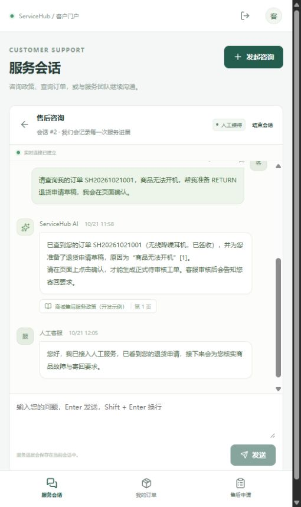
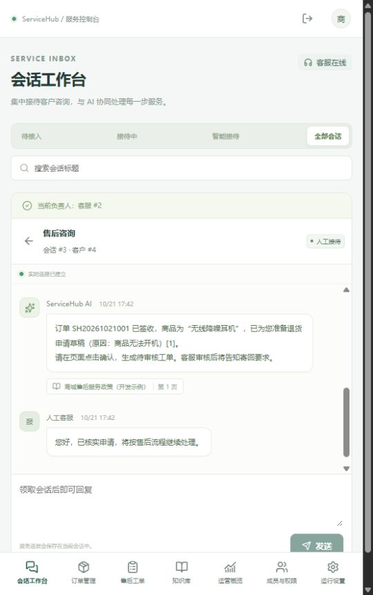

# 实际验证记录：2026-10-21

以下均来自本机实际执行。项目 D:\研究生\简历1\qz-project，分支 feat/servicehub-platform。外部真实模型 Key 仅在未跟踪 .env 中，源码候选文件已按实际 Key 值扫描，未发现泄露。

## 环境

Windows 11 build 26200；AMD Ryzen 9 7945HX，16 核/32 线程，物理可用内存约 15.7 GiB。Docker Desktop 4.96.0，Docker 29.9.1，Compose 5.6.0；引擎可见 32 CPU、约 7.6 GiB 内存。MySQL 8.4、Redis 8.4。宿主 Python 3.12.13，容器 Python 3.12.15。Node 26；前端包版本以 package-lock.json 为准。

接口负载测试使用两个独立宿主 Uvicorn 进程，真实 MySQL servicehub_test、独立 Redis 6380/db0。完整网站使用 Nginx、两个 Uvicorn worker、独立 Worker、MySQL、应用 Redis 6379/db0。

## 回归与实际实验

| 检查 | 本次结果 |
|---|---|
| scripts/verify.ps1（最终修复后） | Ruff 检查/格式通过；后端 94 passed，3 skipped，1 deselected（49.27 秒）；TypeScript 通过；前端 18 passed / 11 文件；生产构建通过 |
| 后端独立单元命令 | 27 passed；后续新增 Embedding 故障分类 3 passed，完整回归已包含 |
| 实际 Embedding 入库/检索 | opt-in online 1 passed，最终复测 7.87 秒；1024 维在线向量写入 Redis HNSW，返回经 MySQL 授权的证据 |
| Worker/Redis 故障实验 | 2 passed，最终复测 29.88 秒；实际终止进程、自然租约过期、另一进程恢复；隔离 Redis 停启与 MySQL 数据核对 |
| 双 API 竞争 | 20 次重复消息只有一条消息/一个任务；20 次确认只有一张工单；20 名客服一人成功、19 个 409 |
| 完整 Docker 网站 | API、Web、MySQL、Redis 健康检查通过，Worker 进程运行；迁移与 seed 独立执行，seed 连续两次不重复建企业/订单 |
| 在线部署 smoke | 最终镜像通过，18.297 秒；真实 RAG 引用、订单工具生成草稿、确认前无工单、重复确认同一工单、人工回复、工单至 RESOLVED |
| 浏览器人工操作 | 通过客户问答、来源引用、Agent 草稿、点击确认产生工单、转人工、客服接单/回复、客户重新登录看到回复、知识就绪与真实运营数据 |

普通测试跳过的三项为两个显式故障实验和一个显式负载入口；它们在独立命令实际运行。deselected 一项为付费在线测试，已另行执行。确定性协议 fixture 用于验证失败和竞态，产品未交付模拟模型适配器。

有一次宿主在线复测出现 embedding_invalid_response（该回合失败，50.12 秒），不能计为通过。随后将超时、连接、429 明确区分为 embedding_timeout、embedding_unavailable、embedding_rate_limited，三个回归测试先失败后通过；在线测试重新执行 1 passed。网络/供应商异常仍会明确失败并按后台策略重试，不提供假回答。

浏览器验收发现并修正了首 token 之前等待提示缺失、重试成功后旧错误残留、窄屏缺少退出入口，均有 RED→GREEN 回归。真实人工接待截图：

## 最终整体审查与修复

最终功能修复提交 7a6a7c0。八项评审问题全部完成 RED→GREEN，随后整套回归通过；没有再次派发评审，也没有遗留延后的小问题：

1. 慢任务期间 Outbox 与任务回收独立前进，有空闲槽时继续领取任务。
2. 单项租约失效只取消该项执行；主动停止 Worker 仍能取消所有子任务。
3. 上下文预算从最新消息向前分配，保留客户最新问题。
4. 重试、最终失败、管理员重试与 AI/文档领域状态在同一有围栏的事务中更新；提交期间租约过期会回滚。
5. 会话快照包含权威 AI 任务状态，重新打开失败会话不会无限显示等待。
6. 关键词和向量检索均先过滤有效版本；旧 Redis schema 与 hash 元数据可原地升级。全文零分时有最多 16 个词元的字面回退，避免直接丢失可匹配资料；这条路径仍需按目标知识库规模测量查询成本。
7. 前端按会话选择代次丢弃迟到的消息发送和历史分页响应。
8. 引用下载带精确版本，客户只可读取自己历史回复引用的旧版本；他人、未引用或停用文档版本不可越权下载。

覆盖见 test_worker_scheduling、test_context_budget、test_failure_outcomes、test_commit_fence、test_active_retrieval、test_citation_download 与 live.recovery.test.tsx。完整取舍及代价见 [执行记录](执行记录.md)。

最终镜像浏览器截图：

## 本机闭环负载观测

| 场景 | 虚拟客户 | 请求/耗时 | 观测吞吐 | P50 | P95 | 错误率 |
|---|---:|---:|---:|---:|---:|---:|
| 业务消息持久化 HTTP | 8 | 430 / 5.095 秒 | 84.40 请求/秒 | 70.61 ms | 102.06 ms | 0 |
| HTTP 到另一进程 WebSocket 同消息 | 4 | 132 / 5.173 秒 | 25.52 请求/秒 | 139.33 ms | 187.49 ms | 0 |

高负载子进程显式放宽消息频控；默认应用仍为每客户每分钟 30 次。这是带 30ms 客户端间隔的闭环观测，未寻找承载上限，不应引用成“生产最大 QPS”。两项均先进入人工等待状态，没有混入模型网络调用。

在线 Agent 单独调用一次，端到端观测 55.170 秒，成功，未据单样本推断分位数或容量。duration=1 表示发起请求窗口，已接收任务仍等待完成，实际运行 55.179 秒。最终完整容器 smoke 中两个在线问答及业务流总计 18.297 秒；不同运行环境、请求内容与网络时刻不能直接比较。模拟模型吞吐未执行。

最终 business/live/fault/smoke 原始报告已归档到本目录 results/；包含运行时间、工作负载、退出码和测量口径。原先单样本 Agent 报告仍在 .cache/load-agent.json，属于最终修复前的观测，不用它推断最终版本容量。复现实测命令见同目录 README；本文固定记录最终复测数字。

## 尚未执行/范围限制

远端 GitHub CI 尚未执行，无远端仓库与推送。未做跨主机备份还原演练、长期 soak 或生产容量测试；生产电商、支付与物流未接入。当前没有全量索引重建命令，需保留 Redis AOF 或逐文档上传新版本重建。完整源码与运维步骤已提供，业务种子为可替换的虚构数据。
